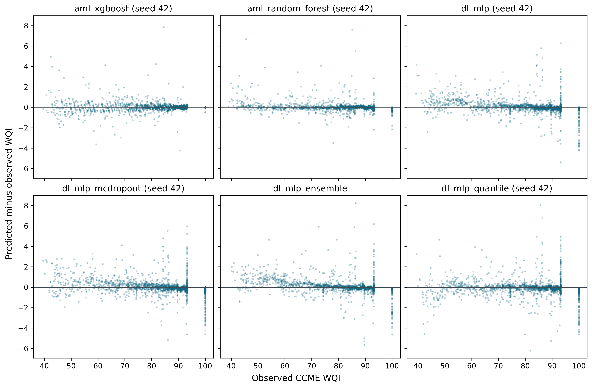
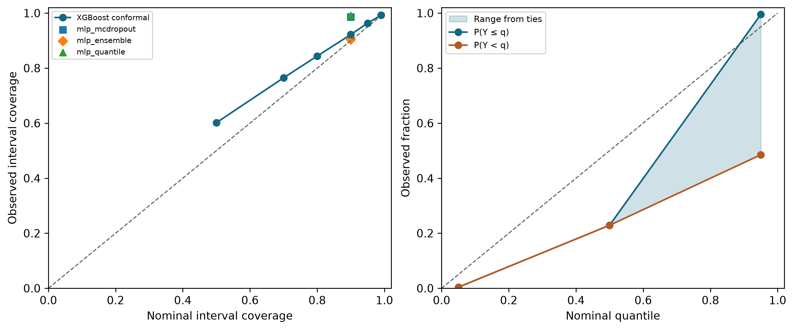
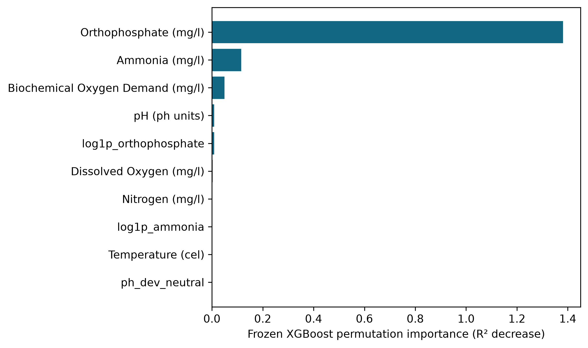
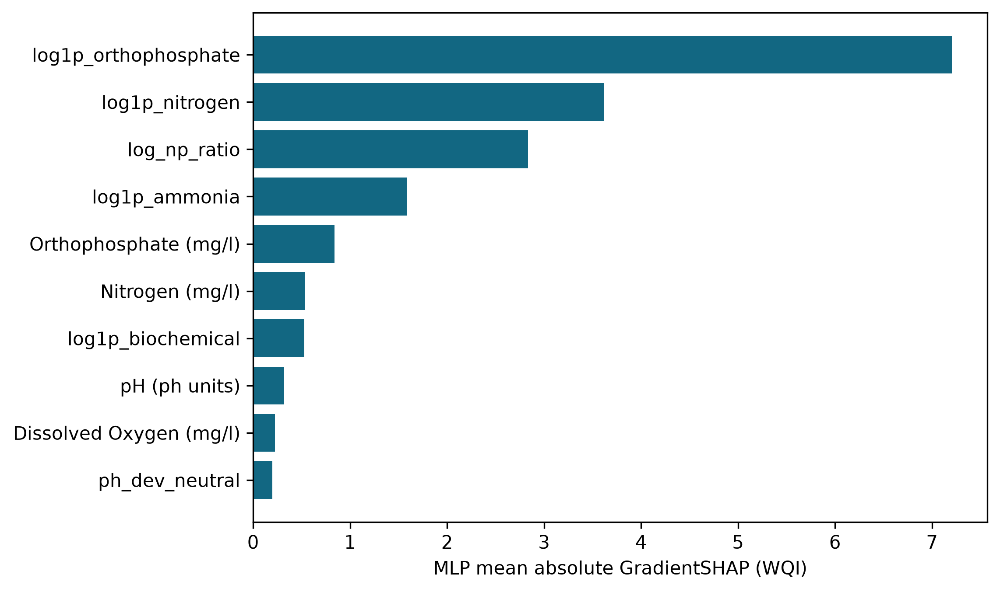
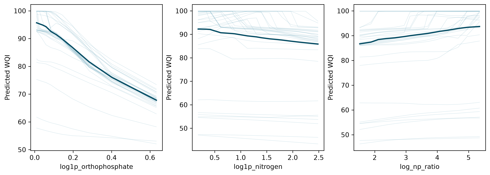

# Water Quality Prediction via Gradient Boosting and Deep Neural Networks

AML + Deep Learning course capstone · Phase 3 evaluation

**Finding.** Random Forest and XGBoost had lower test RMSE than every DL variant on the matched exports. The deep ensemble led the DL variants at 0.5381 WQI points. XGBoost scored 0.3662 and Random Forest scored 0.3464.

## 1. Problem and target definition

The regression target is the supplied continuous CCME Water Quality Index (`CCME_Values`). The CCME index combines the scope, frequency and amplitude of water-quality guideline exceedances on a 0–100 scale. The project also reports hard CCME tiers derived from those scores for secondary classification metrics. [CCME WQI User's Manual](https://ccme.ca/en/res/wqimanualen.pdf)

## 2. Data and missing-data treatment

The AML scope is ambient surface water from 1990 onward. The pipeline retains chemistry units from the cleaned data, with concentration measurements in mg/L, temperature in degrees Celsius and pH on its original scale. The DL bridge uses eight chemistry measurements and 13 engineered variables. Reported preprocessing substitutes half the detection limit for censored readings, sets impossible values to missing, and fits median imputation and standard scaling on the training rows. Trees use unscaled inputs.

## 3. Frozen AML baseline

The original Stage 6 table reports test RMSE 0.3496 for boundary-clipped XGBoost and 0.3310 for Random Forest. The Phase 1 bridge published separate results of 0.3662 and 0.3464. The results below use the bridge because it includes row IDs for matching to DL. The Stage 6 and bridge metrics are quoted from their respective saved outputs.

## 4. MLP design

The final point MLP uses 128, 64, 32 hidden units, RELU activations, batch normalization, dropout 0.1, Huber loss and AdamW with early stopping. DL tuning used 15 Optuna trials. The frozen AML bridge records 15 Optuna GroupKFold trials on Area. The trial counts match and the search objectives, candidate training budgets and validation procedures differ.

## 5. Experimental protocol

The Phase 1 manifest records the AML site-held-out policy (`Area`, seed 42). It contains 250,000 training, 50,000 validation and 50,000 test row positions. All compared saved predictions have the same respective validation and test row IDs and target values. The original AML split archive reproduced all three sampled partitions in order.

<!-- pagebreak -->

## 6. Point prediction and residuals

| Model | Runs | MAE | RMSE | R² | Macro-F1 |
| --- | ---: | ---: | ---: | ---: | ---: |
| XGBoost | 1 | 0.1024 | 0.3662 | 0.9992 | 0.9660 |
| Random Forest | 1 | 0.0964 | 0.3464 | 0.9993 | 0.9732 |
| Point MLP | 5 | 0.2715 ± 0.0266 | 0.5707 ± 0.0199 | 0.9980 ± 0.0001 | 0.9512 ± 0.0059 |
| MC dropout | 5 | 0.2986 ± 0.0219 | 0.6047 ± 0.0168 | 0.9977 ± 0.0001 | 0.9478 ± 0.0072 |
| Deep ensemble | 1 | 0.2528 | 0.5381 | 0.9982 | 0.9548 |
| Quantile MLP | 5 | 0.3137 ± 0.0233 | 0.6149 ± 0.0386 | 0.9977 ± 0.0003 | 0.9479 ± 0.0083 |

WQI errors are in index points. The DL mean ± sample SD reflects separate runs. The deep ensemble is one model built from 5 member seeds. AML metrics are imported. The 1,000-resample paired bootstrap estimated ensemble minus XGBoost RMSE at +0.1719 (95% CI [+0.1455, +0.2010]). The bootstrap resampled 4,231 sites with replacement, retaining all rows belonging to each drawn site.

The saved XGBoost residuals had RMSE 1.037 in the Poor tier and 0.113 in the Excellent tier. The generated tables include site, year and feature-range breakdowns.

Phase 2 logged 13,633 parameters, 13.07 s to train and 0.0095 s to score the test set for the point MLP. The ensemble used 68,165 parameters. The supplied XGBoost artifact is 559,528 bytes and the seed-42 MLP checkpoint is 64,780 bytes. The artifacts use different formats. Random Forest size and comparable AML timings are absent from the frozen inputs.

<!-- pagebreak -->

## 7. Predictive uncertainty

All methods target 90% marginal coverage. PICP is the observed fraction inside the interval. Mean interval width is measured in WQI points. Below and above give the two miss rates.

| Model | Runs | Coverage | Mean width | Below / above |
| --- | ---: | ---: | ---: | ---: |
| XGBoost conformal | 1 | 92.20% | 0.466 | 3.92% / 3.88% |
| MC dropout | 5 | 98.61% ± 0.08 pp | 2.633 ± 0.079 | 0.74% / 0.65% |
| Deep ensemble | 1 | 90.46% | 1.056 | 2.43% / 7.11% |
| Quantile MLP | 5 | 99.12% ± 0.12 pp | 3.491 ± 0.051 | 0.39% / 0.49% |

The XGBoost wrapper takes the finite-sample order statistic of absolute saved validation residuals, applies that single radius to the saved test predictions and clips the bounds to the WQI scale. The validation split also served model selection or early stopping. Site dependence and validation reuse weaken the assumptions for a formal coverage guarantee here. [Angelopoulos and Bates](https://arxiv.org/abs/2107.07511)

The ensemble came closest to 90% among DL models. MC dropout and the quantile MLP both exceeded nominal coverage with much wider intervals. The XGBoost wrapper had the narrowest mean interval. Ties at WQI 100 make strict and inclusive quantile calibration frequencies diverge. The exports contain hard tier labels, so probability calibration metrics require additional probability exports.

<!-- pagebreak -->

## 8. Explainability

The frozen XGBoost evaluation contains TreeSHAP and permutation importance. Orthophosphate (mg/l) led its permutation ranking. This is consistent with sensitivity to nutrient guidelines in the index. The archived ranking describes the fitted model and cannot establish a causal chemistry effect.

The saved seed-42 MLP ranked `log1p_orthophosphate` first by absolute GradientSHAP over 500 test rows. Spearman rank agreement with XGBoost was 0.14 across the 10 features in the archived AML permutation ranking. Correlated and engineered features can divide importance across representations.

As a chemistry check, dissolved oxygen was changed from 8.17 to 11.68 mg/L and its engineered features recomputed. Mean predicted WQI shifted by -0.003 points. The magnitude and direction describe the fitted model over this selected slice. Oxygen changes in a real waterbody can coincide with temperature and other chemistry changes.

<!-- pagebreak -->

## MLP partial dependence and individual responses

These plots vary one model input at a time. Because the inputs include transformed versions of the same chemistry measurements, this can create feature combinations outside the observed range of joint chemistry.

## 9. Feature ablation and limitations

At seed 42 the matched ablations removed `do_deficit`, `log_np_ratio`, `nitrate_to_n_ratio`, `ph_dist_buffer`. XGBoost RMSE rose from 0.3662 to 0.3791 (+0.0129). MLP RMSE rose from 0.5470 to 0.7124 (+0.1654). The remaining chemistry can encode inputs used to construct WQI. Removing engineered proxies measures sensitivity to those proxies and leaves possible formula leakage.

The study holds out sites using the original AML protocol. It has no forward-in-time holdout, so future-period performance and geographic transfer beyond the sampled sites remain untested. Different preprocessing implementations and the heavy mass at WQI 100 also limit interpretation.

## 10. Conclusion

The MLP did not improve point prediction over either frozen tree baseline. The deep ensemble offers the closest DL coverage to the nominal level and the lowest DL point error. The conformal wrapper on XGBoost was narrower at similar observed coverage. These results describe reconstruction of the supplied CCME index on the matched exports.
